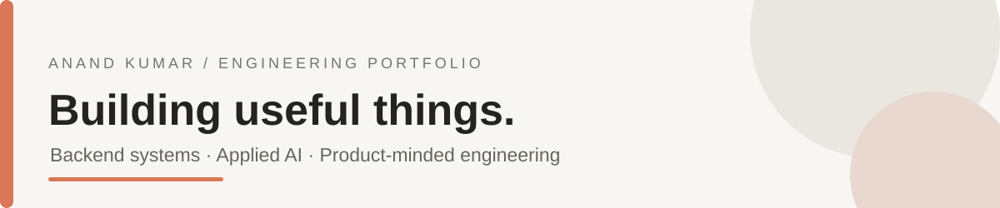
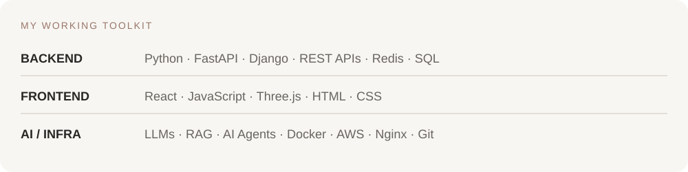

<table>
<tr>
<td width="58%" valign="middle">

# Hey, I'm Anand.

**Software Engineer · Backend Systems · Applied AI**

I build backend services and practical AI-powered tools, with a focus on reliability, measurable performance and clean engineering.

📍 Bengaluru, India  
🎓 B.E. Mechanical Engineering — CMRIT · CGPA 8.76/10

<a href="https://www.linkedin.com/in/anand-kumar-engineer/">LinkedIn</a> ·
<a href="mailto:anandkalpanasingh12345@gmail.com">Email</a> ·
<a href="https://github.com/anand-kumar7890">GitHub</a>

</td>
<td width="42%" valign="middle">

</td>
</tr>
</table>

---

> **Currently focused on:** backend engineering, LLM infrastructure and developer tools.

## 01 · A little about me

I'm interested in the engineering behind useful products: APIs that behave predictably under load, services that are observable, and AI workflows that produce outputs people can actually use.

- Software Developer Intern experience at **Weavum Technologies**
- Built and tested backend APIs using **Python, Django and REST**
- Exploring **FastAPI, Redis, Docker, LLMs and RAG**
- Mechanical engineering background with hands-on CAD experience

## 02 · Selected projects

<table>
<tr>
<td width="50%" valign="top">

### ⚡ LLM-Aware API Rate Limiter

`Python` `FastAPI` `Redis` `Lua` `Docker`

A concurrency-safe rate limiter and token-governance layer designed for LLM APIs.

- Four algorithms implemented with atomic Redis Lua scripts.
- Token reserve/refund accounting and tier-based API keys.
- Daily spend budgets and configurable Redis failure policy.
- 500-concurrent-request race test; 32 automated tests.
- Local benchmark: approximately 1.2 ms p50 per limiter check.

[View repository](https://github.com/anand-kumar7890/LLM-aware-rate-limiter)

</td>
<td width="50%" valign="top">

### 🏭 MechAI Studio

`FastAPI` `React` `Three.js` `CadQuery` `Groq`

An industrial AI platform connecting natural-language instructions with CAD workflows.

- LLM-driven Text-to-CAD generation using CadQuery.
- Geometry validation and STEP/STL export.
- Image-to-CAD, CAD-to-PDF and file conversion utilities.
- JWT authentication and automated tests across 29 API endpoints.

Active project · Add your public repository URL when ready.

</td>
</tr>
</table>

### More projects

| Project | Focus |
|---|---|
| [Wall Climbing Robot](https://github.com/anand-kumar7890/Wall_Climbing_Robot) | EDF suction adhesion, Arduino, NodeMCU and SolidWorks |
| [Customer Personality Analysis](https://github.com/anand-kumar7890/Customer_Personality_Analysis) | Python data analysis and customer segmentation |

## 03 · Toolkit

## 04 · Experience

**Software Developer Intern — Weavum Technologies Pvt. Ltd.**  
*September 2024 – January 2025 · Bengaluru*

- Developed and deployed Django backend services and REST APIs, improving page-load performance by 35%.
- Optimized data-processing workflows, reducing API response time by 28%.
- Built reusable components following software design patterns, reducing code redundancy by 40%.
- Worked with frontend and backend teams to deliver product features.

**Cyber Security Intern — IBM SkillsBuild / Edunet Foundation**  
*June 2023 – July 2023 · Remote*

- Built a multithreaded Python security-monitoring project.
- Implemented encryption and secure telemetry logging.
- Analyzed vulnerabilities and recommended endpoint security improvements.

## 05 · Leadership & recognition

- **President, SME Club, CMRIT (2024–2025):** Led technical sessions for 100+ students and organized workshops, industrial visits and project exhibitions.
- **President, NSS Club, CMRIT (2023–2024):** Led 10+ outreach initiatives and coordinated 30+ volunteers.
- **Oracle Cloud Infrastructure 2025 — AI Foundations Associate**, Oracle University.
- **CMR Leadership Award**, CMR Institute of Technology.

## 06 · GitHub activity

## 07 · Find me

**Open to software engineering, backend, platform and applied AI opportunities.**

[LinkedIn](https://www.linkedin.com/in/anand-kumar-engineer/) ·
[LeetCode](https://leetcode.com/u/ak_world_7890/) ·
[Codeforces](https://codeforces.com/profile/anand-kumar7890) ·
[Email](mailto:anandkalpanasingh12345@gmail.com)

Made with curiosity, care and a bias toward building.

