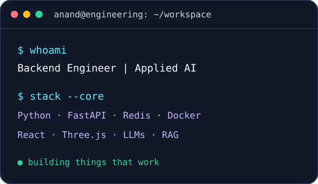
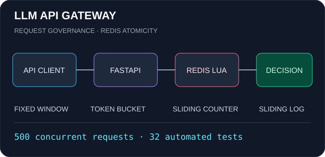
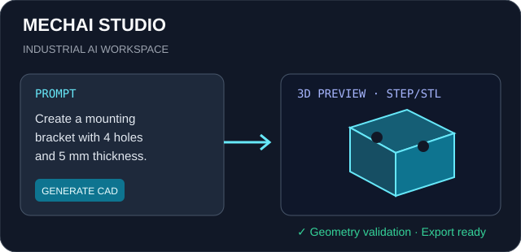

# ANAND KUMAR

### SOFTWARE ENGINEERING · BACKEND SYSTEMS · APPLIED AI

**I build reliable backend systems and turn AI ideas into practical engineering tools.**

---

<table>
<tr>
<td width="58%" valign="top">

## `01 / ABOUT`

I'm **Anand Kumar**, a software engineer focused on backend engineering, infrastructure and applied AI.

I enjoy building systems that are measurable, testable and dependable—not just impressive in a demo.

- **Based in:** Bengaluru, India
- **Education:** B.E. Mechanical Engineering, CMRIT
- **CGPA:** 8.76 / 10
- **Experience:** Software Developer Intern, Weavum Technologies

</td>
<td width="42%" valign="top">

</td>
</tr>
</table>

## `02 / ENGINEERING WORK`

<table>
<tr>
<td width="50%" valign="top">

### ⚡ LLM-Aware API Rate Limiter

`FASTAPI` `REDIS` `LUA` `DOCKER`

A concurrency-safe traffic and token governance layer for LLM APIs.

- Four rate-limiting algorithms implemented as atomic Redis Lua scripts.
- Token reservation/refund, tiered API keys and daily spend budgets.
- Race-tested with **500 concurrent requests**.
- **32 automated tests**; local benchmark around **1.2 ms p50**.

</td>
<td width="50%" valign="top">

### 🏭 MechAI Studio

`FASTAPI` `REACT` `THREE.JS` `CADQUERY` `GROQ`

An industrial AI workspace connecting natural language to CAD workflows.

- LLM-driven Text-to-CAD with CadQuery code generation.
- Geometry validation and STEP/STL export.
- Image-to-CAD, CAD-to-PDF and file conversion utilities.
- JWT authentication and tests across 29 API endpoints.

</td>
</tr>
</table>

### Other projects

| Project | What it demonstrates |
|---|---|
| [Wall Climbing Robot](https://github.com/anand-kumar7890/Wall_Climbing_Robot) | Mechanical design, EDF suction adhesion, Arduino and wireless control |
| [Customer Personality Analysis](https://github.com/anand-kumar7890/Customer_Personality_Analysis) | Python-based exploratory data analysis |

## `03 / TECH STACK`

## `04 / EXPERIENCE`

**Software Developer Intern — Weavum Technologies**  
*September 2024 – January 2025 · Bengaluru*

- Developed Django backend services and REST APIs, improving page-load performance by 35%.
- Optimized data-processing workflows, reducing API response time by 28%.
- Built reusable components that reduced code redundancy by 40%.
- Collaborated with cross-functional teams to deliver product features.

**Cyber Security Intern — IBM SkillsBuild / Edunet Foundation**  
*June 2023 – July 2023 · Remote*

- Built a multithreaded Python security-monitoring project.
- Implemented encrypted telemetry logging and analyzed endpoint vulnerabilities.

## `05 / LEADERSHIP & RECOGNITION`

- **President, SME Club, CMRIT (2024–2025):** Led technical sessions for 100+ students and organized workshops and industrial visits.
- **President, NSS Club, CMRIT (2023–2024):** Led 10+ outreach initiatives and coordinated 30+ volunteers.
- **Oracle Cloud Infrastructure 2025 — AI Foundations Associate**, Oracle University.
- **CMR Leadership Award**, CMR Institute of Technology.

## `06 / GITHUB ACTIVITY`

## `07 / LET'S CONNECT`

**Have a backend, platform engineering or applied AI problem worth solving? Let's talk.**

[LinkedIn](https://www.linkedin.com/in/anand-kumar-engineer/) ·
[LeetCode](https://leetcode.com/u/ak_world_7890/) ·
[Codeforces](https://codeforces.com/profile/anand-kumar7890) ·
[Email](mailto:anandkalpanasingh12345@gmail.com)

ENGINEERED WITH CURIOSITY · BUILT WITH INTENT

