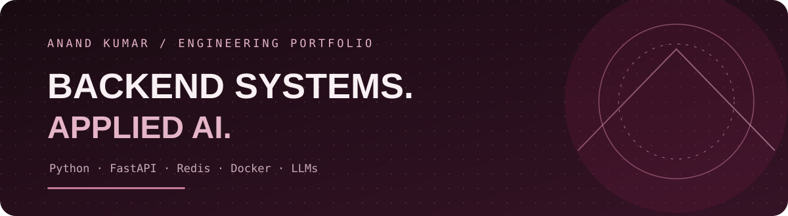
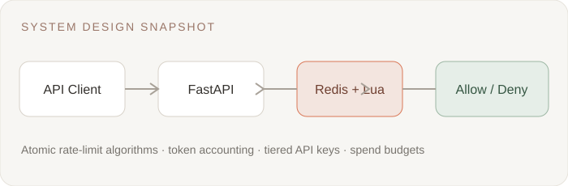
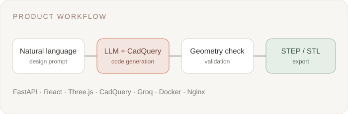

  
   
  
  
  
    
  

<table>
<tr>
<td width="62%" valign="top">

## `01 / THE ENGINEER`

I'm **Anand Kumar** — a software engineer interested in the space where **backend engineering, infrastructure and applied AI** meet.

I like building systems that are not just impressive in a demo, but measurable, testable and dependable in production. Recently, that has meant atomic Redis rate limiting for LLM APIs and an AI-assisted CAD workflow for mechanical engineering.

**Currently building:** MechAI Studio · LLM-aware API Rate Limiter  
**Based in:** Bengaluru, India  
**Education:** B.E., CMR Institute of Technology · 8.76/10

</td>
<td width="38%" valign="top">

</td>
</tr>
</table>

## `02 / WHAT I BUILD`

<table>
<tr>
<td width="50%" valign="top">

### ⚡ LLM-Aware API Rate Limiter
`FASTAPI` `REDIS` `LUA` `DOCKER`

A concurrency-safe traffic and token governance layer for LLM APIs.

- Four algorithms implemented as atomic Redis Lua scripts.
- Token reservation/refund, tiered API keys and daily spend budgets.
- Race-tested at **500 concurrent requests**; 32 automated tests.
- Local benchmark: ~**1.2 ms p50** limiter check.

[↗ Explore the repository](https://github.com/anand-kumar7890/LLM-aware-rate-limiter) · [Live demo](https://llm-aware-rate-limiter.onrender.com/)
</td>
<td width="50%" valign="top">

### 🏭 MechAI Studio
`FASTAPI` `REACT` `THREE.JS` `CADQUERY` `GROQ`

An industrial AI workspace connecting natural language to practical CAD workflows.

- LLM-driven Text-to-CAD with CadQuery code generation.
- Geometry validation and STEP/STL export.
- Image-to-CAD, CAD-to-PDF and file conversion utilities.
- JWT authentication and tests across 29 API endpoints.

Active project · Details from my resume
</td>
</tr>
<tr>
<td width="50%" valign="top">

### 🧗 Wall Climbing Robot
`ARDUINO` `NODEMCU` `SOLIDWORKS`

A mechanically designed wall-climbing robot using EDF-based suction adhesion, wireless control and a custom monitoring interface.

[↗ Explore the repository](https://github.com/anand-kumar7890/Wall_Climbing_Robot)
</td>
<td width="50%" valign="top">

### 📊 Customer Personality Analysis
`PYTHON` `DATA ANALYSIS`

An exploratory data analysis project focused on customer attributes, patterns and segmentation insights.

[↗ Explore the repository](https://github.com/anand-kumar7890/Customer_Personality_Analysis)
</td>
</tr>
</table>

## `03 / THE TOOLKIT`

<table>
<tr><td width="25%"><b>BACKEND</b></td><td>Python · FastAPI · Django · REST APIs · Redis · Nginx</td></tr>
<tr><td><b>FRONTEND</b></td><td>React · JavaScript · Three.js · Bootstrap</td></tr>
<tr><td><b>AI ENGINEERING</b></td><td>LLMs · Generative AI · RAG · AI Agents · Groq API</td></tr>
<tr><td><b>INFRASTRUCTURE</b></td><td>Docker · AWS · Git · GitHub · Prometheus</td></tr>
<tr><td><b>DATA</b></td><td>MySQL · SQLite · SQL</td></tr>
<tr><td><b>ENGINEERING</b></td><td>CadQuery · SolidWorks · 3D CAD workflows</td></tr>
</table>

  

## `04 / THE JOURNEY`

<table>
<tr>
<td width="18%"><b>2024 — 2025</b></td>
<td><b>Software Developer Intern · Weavum Technologies</b> Built Django services and REST APIs; improved page-load performance by 35%, reduced API response time by 28%, and cut code redundancy by 40%.</td>
</tr>
<tr>
<td><b>2023</b></td>
<td><b>Cyber Security Intern · IBM SkillsBuild / Edunet Foundation</b> Built a multithreaded Python security-monitoring project and implemented encrypted telemetry logging.</td>
</tr>
<tr>
<td><b>2021 — 2025</b></td>
<td><b>B.E. · CMR Institute of Technology, Bengaluru</b> CGPA: 8.76/10 · Mechanical Engineering</td>
</tr>
</table>

## `05 / BEYOND THE CODE`

- **President, SME Club (2024–2025):** Led technical sessions for 100+ students; organized workshops, industrial visits and project exhibitions.
- **President, NSS Club (2023–2024):** Led 10+ outreach initiatives and coordinated 30+ volunteers.
- **Oracle Cloud Infrastructure 2025 — AI Foundations Associate**, Oracle University.
- **CMR Leadership Award**, CMR Institute of Technology.

## `06 / GITHUB SIGNAL`

  
  
   
  
   
  

## `07 / FIND ME`

**Have a backend, platform engineering or applied AI problem worth solving? Let's talk.**

[LinkedIn](https://www.linkedin.com/in/anand-kumar-engineer/) &nbsp;·&nbsp; [LeetCode](https://leetcode.com/u/ak_world_7890/) &nbsp;·&nbsp; [Codeforces](https://codeforces.com/profile/anand-kumar7890) &nbsp;·&nbsp; [Email](mailto:anandkalpanasingh12345@gmail.com)

ENGINEERED WITH CURIOSITY · BUILT WITH INTENT

