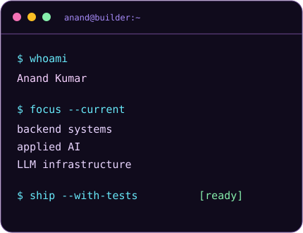
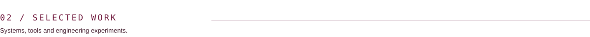
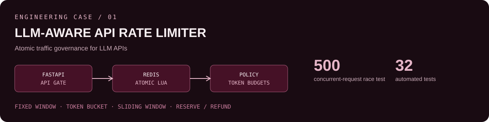
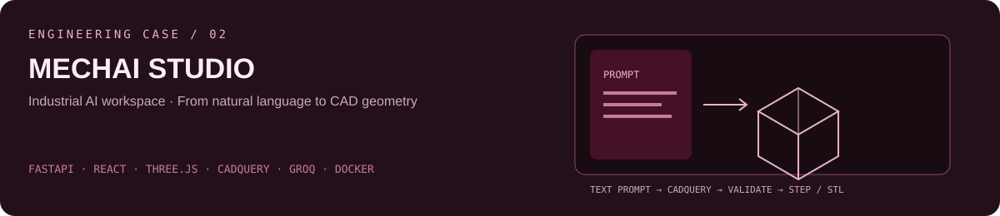
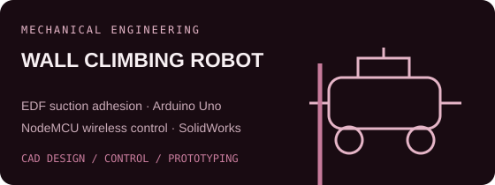
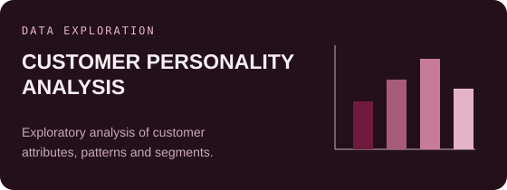

  
  
  

<table>
  <tr>
    <td width="62%" valign="top">
      <h3>Hi, I'm Anand Kumar.</h3>
      I'm a software engineer focused on the intersection of <strong>backend engineering, infrastructure and applied AI</strong>. I enjoy building systems that are measurable, testable and dependable—not just impressive in a demo.
        
      <strong>Currently building:</strong> MechAI Studio and LLM-aware API infrastructure 
      <strong>Based in:</strong> Bengaluru, India 
      <strong>Education:</strong> B.E. Mechanical Engineering · CMR Institute of Technology · 8.76/10
    </td>
    <td width="38%" valign="top"></td>
  </tr>
</table>

  
  

MechAI Studio · Active project · FastAPI, React, Three.js, CadQuery, Groq, Docker and Nginx

<table>
  <tr>
    <td width="50%" valign="top">
      
      
<a href="https://github.com/anand-kumar7890/Wall_Climbing_Robot">VIEW REPOSITORY ↗</a>

    </td>
    <td width="50%" valign="top">
      
      
<a href="https://github.com/anand-kumar7890/Customer_Personality_Analysis">VIEW REPOSITORY ↗</a>

    </td>
  </tr>
</table>

  

<table>
  <tr><td width="22%"><strong>SEP 2024 — JAN 2025</strong></td><td><strong>Software Developer Intern · Weavum Technologies</strong> Built Django backend services and REST APIs; improved page-load performance by 35%, reduced API response time by 28%, and reduced code redundancy by 40%.</td></tr>
  <tr><td><strong>JUN — JUL 2023</strong></td><td><strong>Cyber Security Intern · IBM SkillsBuild / Edunet Foundation</strong> Built a multithreaded Python security-monitoring project and implemented encrypted telemetry logging.</td></tr>
  <tr><td><strong>2021 — 2025</strong></td><td><strong>B.E. Mechanical Engineering · CMR Institute of Technology</strong> Bengaluru · CGPA 8.76/10</td></tr>
</table>

- **Oracle Cloud Infrastructure 2025 Certified AI Foundations Associate** — Oracle University.
- **CMR Leadership Award** — CMR Institute of Technology.
- **President, SME Club (2024–2025):** Led technical sessions for 100+ students and organized workshops, industrial visits and project exhibitions.
- **President, NSS Club (2023–2024):** Led 10+ outreach initiatives and coordinated 30+ volunteers.

  <a href="https://www.linkedin.com/in/anand-kumar-engineer/">LINKEDIN</a> ·
  <a href="https://leetcode.com/u/ak_world_7890/">LEETCODE</a> ·
  <a href="https://codeforces.com/profile/anand-kumar7890">CODEFORCES</a> ·
  <a href="mailto:anandkalpanasingh12345@gmail.com">EMAIL</a>

ENGINEERED WITH CURIOSITY · BUILT WITH INTENT

